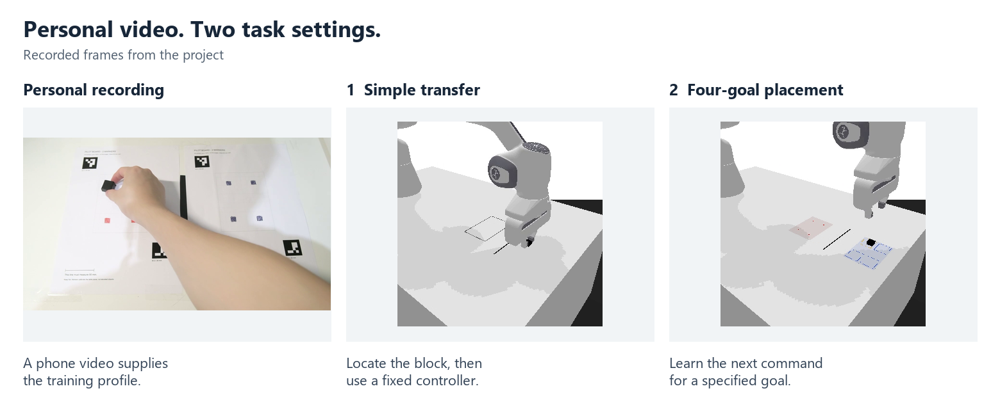
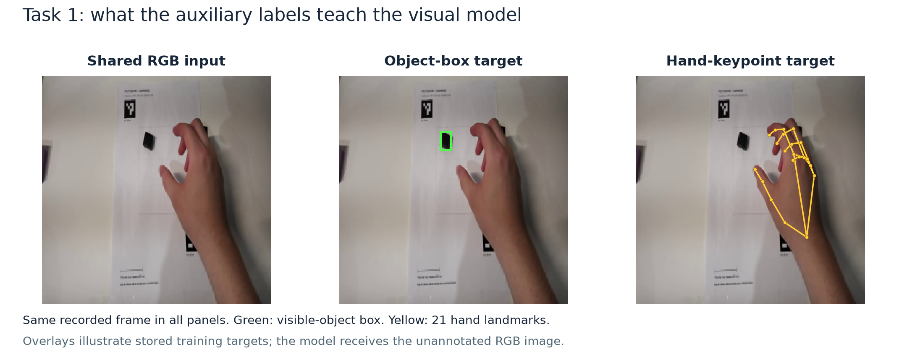
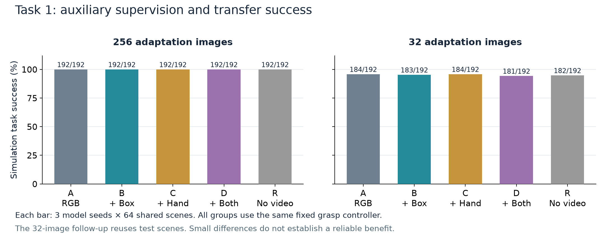
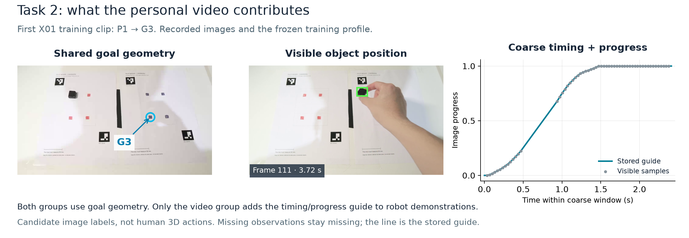

# simu-lab

### Learning robot manipulation from personal video

Can a few phone recordings help a robot learn to pick up and place a block? This project follows that question from a simple transfer task to a task with four start locations and four specified goals. All robot experiments run in a contact-based Panda simulation.

[Overview](docs/OVERVIEW.md) · [Experiments](docs/EXPERIMENTS.md) · [Run a policy](docs/QUICKSTART.md) · [Data & models](docs/DATA_MODEL_CARD.md) · [Downloads](https://github.com/jinzzze/simu-lab/releases/tag/v1.1.0)

*Recorded human demonstration and simulated robot executions. [Watch the 92-second walkthrough](https://github.com/jinzzze/simu-lab/releases/download/v1.1.0/evidence_walkthrough.mp4). These are illustrative frames; measured performance is reported below.*

## The two tasks

### Task 1 · Simple transfer

Pick up a small block and place it entirely beyond a black line. Release it, withdraw the gripper and leave the block stable on the far side.

### Task 2 · Four-goal placement

Start at one of P1–P4 and move the block to the specified goal, G1–G4. The start and goal can have different numbers. The entire block must finish inside the selected 40 mm target square after release and withdrawal.

The second task adds a specified destination and a tighter placement requirement. Both diagrams show task layouts, not measured trajectories; they are not to scale.

## From seeing the block to choosing the next move

The first task asked the robot to lift a block and place it beyond a line. A learned visual model estimated the block's position; a fixed controller carried out the grasp. This made it possible to study what the personal videos contributed to perception.

The next experiments explored skill-outcome prediction and learned robot commands. The task then expanded to four starts and four goals: the policy had to use the requested destination and place the entire block inside a 40 mm square. The final comparison tested whether video-derived transport timing and image progress helped beyond the goal geometry already shared by both groups.

Each stage asks a different question. The outcome predictor is a supporting study, not a planner used by the four-goal policy. [Read the study progression](docs/OVERVIEW.md).

## Task 1: learning from object boxes and hand positions

**Question:** do object boxes and hand positions help visual learning? Twelve phone clips provide 438 shared RGB frames. Green boxes and 21 yellow hand landmarks below are stored auxiliary targets; the model sees the unannotated image.

**Comparison:** A = RGB only; B = + object box; C = + hand keypoints; D = + both. R skips phone-video pretraining. All groups adapt to simulated images and share a fixed grasp controller.

**Result:** all groups score 192/192 with 256 adaptation images. With 32, A/B/C/D/R score 184/183/184/181/182. Combined supervision shows no success advantage. Labels are unvalidated candidates; the 32-image follow-up reuses test scenes.

[Full report](docs/studies/SIMPLE_TRANSFER.md) · [Localization results](artifacts/reports/visual_ablation_v1/comparison.png) · [Label-review examples](artifacts/diagnostics/pilot_labels_v2/619481ad2df077adff353cb4ced816b5_review.jpg) · [Figure sources](media/task-1-figure-sources.json)

## Task 2: learning from video timing and progress

**Question:** does video timing help beyond knowing the goal? Both groups use goal locations from 24 personal clips. One also uses coarse transport time and visible 2D progress, illustrated below, to shape simulated robot demonstrations.

**Comparison:** shared geometry versus added timing/progress; 24 robot demonstrations per group, the same recurrent policy, 2,500 updates and three seeds. At runtime, the policy uses current RGB, robot state, goal and previous command.

**Result:** 7/96 versus 11/96 strict placements (7.3% versus 11.5%); a reliable benefit is not established. Most runs fail to lift: 75/96 versus 69/96. Eight physical starts are reused, and four initial test images overlap training/development; exclusions are reported separately.

[Full results and exclusions](experiments/personal_video_timing_v4/RESULTS_EN.md) · [Video-to-command comparison](experiments/personal_video_timing_v4/artifacts/intervention_audit_v1/REPORT_EN.md) · [Method](docs/METHOD.md) · [Figure sources](media/task-2-figure-sources.json)

Training and execution diagram

## What the experiments found

| Question | Measured result | What it tells us |
|---|---|---|
| Do hand and object targets improve the visual model? | With 32 simulation adaptation images: RGB-only **184/192**, combined targets **181/192** successful transfers | No measured success advantage from the combined targets |
| Can a model predict a fixed skill's outcome? | Mean endpoint error **28.41 mm**, versus **90.89 mm** for a no-motion baseline | Useful prediction on this simulated distribution; planning benefit was not tested |
| Does video timing help the four-goal learner? | Shared geometry **7/96**; added timing/progress **11/96** strict placements | A small observed difference; overall success is low and a reliable benefit is not established |

The tasks, controllers and data budgets differ across rows. The [experiment guide](docs/EXPERIMENTS.md) includes the learned-action and goal-coverage studies, all model seeds and links to the underlying results.

## Run the recorded policy

Start with the [quick replay guide](docs/QUICKSTART.md). It runs two frozen development cases and compares their observations, actions and scores with the recorded traces.

- **Runtime:** Windows, Conda and an NVIDIA CUDA GPU; Python 3.11.
- **Download:** the **12.8 MB replay ZIP** for the two cases, or the **1.80 GB evidence ZIP** for all six models and the current study's inputs and traces. A source clone alone does not contain the weights.
- **Expected result:** both reference cases fail strict placement. A successful replay check reproduces that recorded behavior.

| I want to… | Start here |
|---|---|
| Understand the project | [Overview](docs/OVERVIEW.md) |
| Run an existing policy | [Quickstart](docs/QUICKSTART.md) |
| Repeat training | [Training guide](docs/TRAINING.md) |
| Revisit the simple task | [Stage 1 reproduction](docs/SIMPLE_TASK_REPRODUCTION.md) |
| Inspect every result | [Experiments](docs/EXPERIMENTS.md) and [evidence index](docs/EVIDENCE.md) |
| Find the implementation | [Code map](docs/CODE_MAP.md) |

## Scope and credits

This is a small simulation study. There is no real-robot evaluation or language-conditioned policy. The recordings share a limited scene family, and the extracted image labels do not recover human metric 3D actions. Exact replay was checked on the original Windows host with an independently installed environment; another-machine compatibility and full-retraining determinism remain unverified.

The author collected the personal recordings and confirmed the task layout. Codex assisted with implementation, experiment execution, candidate-label inspection and writing. Recordings and project checkpoints are public with permission; no blanket source/data/model reuse license has been granted. See [data provenance](docs/DATA_MODEL_CARD.md) and [third-party notices](THIRD_PARTY_NOTICES.md).
