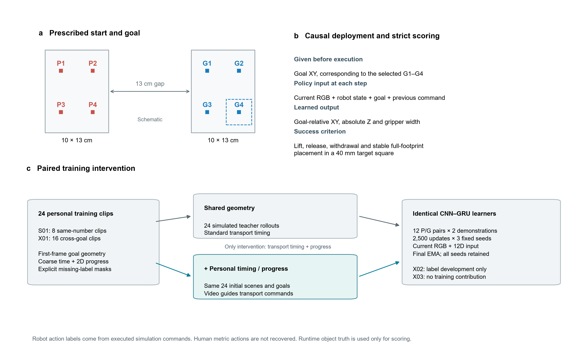

# simu-lab · Personal video for robot learning

An exploratory study of how personally recorded phone videos can contribute to robot perception, state prediction and goal-conditioned control in a contact-based Panda simulation.

**Latest experiment:** two recurrent policies share the same video-derived goal geometry and robot demonstration budget; one also uses coarse timing and image progress from the personal videos to shape its training demonstrations. Strict test success is **7/96 versus 11/96**. Overall success is low, and this small observed difference does not establish a reliable improvement.

[Watch the 92-second walkthrough](https://github.com/jinzzze/simu-lab/releases/download/v1.1.0/evidence_walkthrough.mp4) · [Quick replay](docs/QUICKSTART.md) · [Full results](experiments/personal_video_timing_v4/RESULTS_EN.md) · [Release downloads](https://github.com/jinzzze/simu-lab/releases/tag/v1.1.0)

## Task and personal data

The applicant recorded moving a black block from four red source positions P1–P4 to four blue target centers G1–G4. The measured grids are 100 × 130 mm, separated by a 130 mm edge-to-edge gap. The simulator uses an engineered tabletop mapping; this is not calibrated real-robot registration.

At the start of each robot episode, the desired target XY is supplied explicitly. At every control step, the learned CNN–GRU receives **current RGB, robot proprioception, that goal and the previous command**. It predicts the next robot command. It does not receive object ground truth, a scripted phase, an external clock or a human trajectory at deployment.

Strict success requires lifting, release, withdrawal and stable placement of the **entire object footprint inside the prescribed 40 mm goal square**. Merely crossing the separator is insufficient. Grasping uses simulated contact forces; the object is never attached to or teleported with the gripper.

The latest comparison uses 24 personal training clips: eight preselected S01 recordings and all 16 X01 recordings. X02 has 12 development clips; X03 has 16 held-out clips, processed separately after the policies were frozen. These are recording blocks from the same scene family, not broad real-world diversity. [Data and model card](docs/DATA_MODEL_CARD.md)

## What the video contributes

| | Shared geometry | Geometry + video timing/progress |
|---|---|---|
| Personal training sources | Same 24 clips | Same 24 clips |
| Target geometry | First-frame blue target centers | Identical geometry |
| Teacher transport | Ordinary transport schedule | Matching clip's coarse transfer duration and dimensionless image progress |
| Robot demonstrations | 24, covering 12 P/G combinations | 24, with paired initial scenes and the same 12 combinations |
| Learner and selection | CNN–GRU, seeds 7/17/27, 2,500 updates each, final EMA | Same architecture, paired initialization/sampling/augmentation and update count |

Video constraints change the executed teacher commands, which become robot action labels. They are **not recovered human 3D actions**. Invalid image labels remain masked; MediaPipe hand candidates are used for inspection, not as an extra input or loss in this comparison. Teacher failures are retained. Different trajectory lengths mean the comparison does not have equal frame targets or equal compute. [Intervention evidence](experiments/personal_video_timing_v4/artifacts/intervention_audit_v1/REPORT_EN.md)

## Results and failures

| Frozen test category | Shared geometry | + Video timing/progress |
|---|---:|---:|
| Same-number pairs | 0/24 | 3/24 |
| Seen cross-goal pairs | 6/48 | 6/48 |
| Held-out pairs | 1/24 | 2/24 |
| **All pairs** | **7/96 (7.3%)** | **11/96 (11.5%)** |

Held-out pairs are P1–G2, P2–G3, P3–G4 and P4–G1. Each condition runs 32 tasks with three policy seeds, sharing **eight physical initial positions**; 96 is an execution count, not a count of independent environments. In total, the study contains 60 teacher trajectories, six trained models, 72 validation executions and 192 test executions.

Most failures occur before a qualified lift: 75/96 and 69/96 executions respectively. Both teachers lift successfully in 24/24 attempts, so the bottleneck is the learned closed-loop policy. The walkthrough includes the predeclared first test case for both groups; its successful video-policy rollout is not representative of the overall success rate.

Four initial test-task images match training/development pixels despite disjoint seeds. Excluding these tasks gives **5/84 versus 8/84**; excluding all goals for the two affected physical starts gives **4/72 versus 7/72**. These post-hoc sensitivity checks retain the original results and add no executions. [All seeds, budgets and overlap details](experiments/personal_video_timing_v4/RESULTS_EN.md)

## Reproduce the evidence

Start with [the quick replay guide](docs/QUICKSTART.md). The small replay ZIP contains two seed-7 checkpoints and fixed development-case references; the full evidence ZIP adds all six models, personal input videos, processed labels, teacher trajectories, evaluation traces and frozen source snapshots. Large files are Release assets, not Git objects. Each ZIP has a file manifest; `SHA256SUMS.txt` checks the downloads.

The tested runtime is Windows, Python 3.11, CUDA-enabled PyTorch 2.10.0 and conda-forge PyBullet. Current inference requires an NVIDIA CUDA GPU. Torch and Bullet run in separate processes. Two fixed cases were reproduced with identical input/action arrays and scoring traces from a relocated archive using an existing independent environment on the same host. This does not establish another-machine compatibility or full-training determinism. Both fixed development cases fail strict placement; matching the recorded failure is a valid reproduction.

[Environment and exact commands](docs/QUICKSTART.md) · [Fresh training workspace](docs/TRAINING.md) · [Machine-readable results](experiments/personal_video_timing_v4/artifacts/results_v1/results.json)

## Earlier experiments, kept separate

These studies ask different questions and use different controllers, data budgets and success criteria. Their rates must not be pooled with the latest task.

| Study | Measured result | Interpretation |
|---|---|---|
| Real-video visual auxiliary supervision | With 32 simulation adaptation images: RGB-only 184/192, combined hand/object targets 181/192 | No measured combined-target success advantage; fixed grasp controller |
| Action-conditioned fixed-skill state prediction | Learned ensemble endpoint error 28.41 mm vs 90.89 mm zero-displacement baseline; outcome labels correct in 153/160 transitions | Predicts skill outcomes from simulation transitions; 153/160 is classification accuracy, not robot success; planning benefit was not evaluated |
| Compact Diffusion Policy | 84/192 strict placements | Additional 128 simulated training trajectories and a different control budget; not a matched comparison with the visual ablation |
| [Four-goal coverage comparison](experiments/cross_goal_composition_v3/COVERAGE_REPORT_EN.md) | Same-number training 22/96 vs 12-combination training 15/96; held-out 0/24 vs 2/24 | Equal demonstration counts did not yield an overall gain; shared S01 geometry, without new video timing |

[Earlier methods and full reports](README_v1.0.0.md) · [State-prediction model](docs/GRASP_WORLD_MODEL.md) · [Original v1.0.0 data and checkpoints](https://github.com/jinzzze/simu-lab/releases/tag/v1.0.0)

## Scope and provenance

All policy execution reported here is simulation-only. There is no real-robot evaluation, language-conditioned VLA, validated human metric 3D motion recovery or demonstrated world-model planning gain. Candidate label coverage is not label accuracy. X03 was previously viewed for applicant-requested naming/QC; it is not claimed never viewed.

The applicant personally supplied the recordings. Codex assisted with implementation, execution, candidate-label inspection and writing. The release preserves source/configuration hashes, failed trials and declared information boundaries. Public distribution of the recordings and derived models is authorized; no blanket source/data/model license has been granted. Third-party terms remain separate. [Source notices](THIRD_PARTY_NOTICES.md) · [Challenge alignment](docs/CHALLENGE_ALIGNMENT.md)
