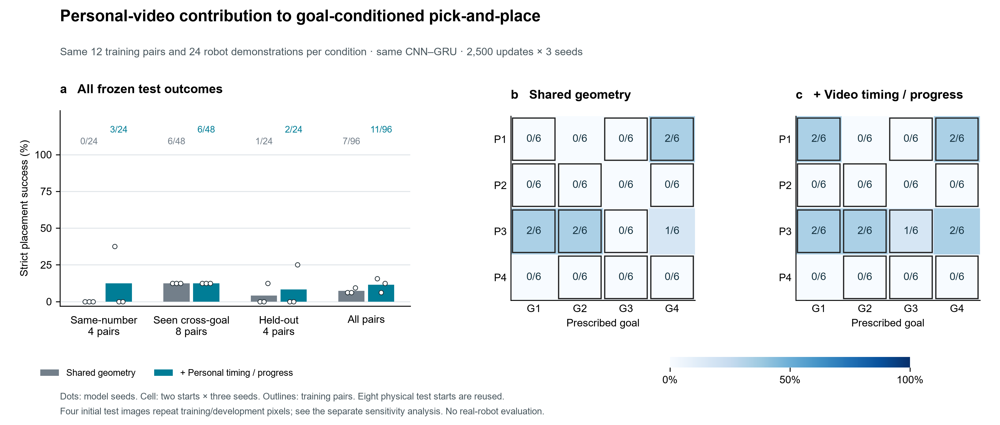

# Experiments and findings

[Overview](OVERVIEW.md) · [Method](METHOD.md) · [Evidence](EVIDENCE.md)

These experiments develop one research question across two task settings. Each comparison has its own controller, data budget and success rule. Counts are reported within those comparisons rather than pooled across stages.

| Stage | Task and question | Result | Detail |
|---|---|---|---|
| Visual learning | Simple transfer; do hand/object targets help perception? | No measured combined-target success advantage | [Visual study](studies/SIMPLE_TRANSFER.md) |
| Outcome prediction | Predict what a complete fixed grasp skill will do | 28.41 mm mean endpoint error versus 90.89 mm no-motion baseline | [Predictor](studies/OUTCOME_PREDICTION.md) |
| Learned commands | Replace the fixed controller with a compact action policy | 84/192 strict simple-transfer successes | [Diffusion Policy](studies/LEARNED_ACTIONS.md) |
| Goal coverage | Extend from four paired tasks to twelve start/goal pairs | Overall 22/96 versus 15/96; held-out 0/24 versus 2/24 | [Coverage report](../experiments/cross_goal_composition_v3/COVERAGE_REPORT_EN.md) |
| Video timing | Test additional timing/progress beyond shared goal geometry | 7/96 versus 11/96 strict four-goal placements | [Latest results](../experiments/personal_video_timing_v4/RESULTS_EN.md) |

## Latest comparison: four-goal placement

Each condition has 24 robot demonstrations covering the same twelve start/goal combinations. P1→G2, P2→G3, P3→G4 and P4→G1 are withheld. The locations themselves are known; the held-out task is their combination.

| Test category | Shared geometry | + Video timing/progress |
|---|---:|---:|
| Same-number pairs | 0/24 | 3/24 |
| Seen cross-goal pairs | 6/48 | 6/48 |
| Held-out combinations | 1/24 | 2/24 |
| **All pairs** | **7/96 (7.3%)** | **11/96 (11.5%)** |

| Model seed | Shared geometry | + Video timing/progress |
|---|---:|---:|
| 7 | 2/32 | 5/32 |
| 17 | 2/32 | 2/32 |
| 27 | 3/32 | 4/32 |

The pooled difference is +4.2 percentage points. The study does not establish a reliable or statistically significant benefit. Each condition evaluates 32 tasks with three model seeds and reuses eight physical start poses; 96 is an execution count, not a count of independent environments.

## Failures and initial-image overlap

The shared-geometry group has 75 runs without a qualified lift and 14 that lift but fail strict placement. The video group has 69 and 16 respectively. Both teachers achieved 24/24 lifts and 20/24 placements during collection; teacher scores are not learned-policy scores.

Four initial test-task images match training/development images despite disjoint scene seeds. Excluding those tasks gives 5/84 versus 8/84. Excluding every goal at the two affected physical starts gives 4/72 versus 7/72. These are post-hoc sensitivity checks, not a replacement test.

All six models, 72 validation executions and 192 test executions are retained. The [full report](../experiments/personal_video_timing_v4/RESULTS_EN.md) includes training budgets, per-seed lift counts, placement errors and failure diagnostics. The [machine-readable record](../experiments/personal_video_timing_v4/artifacts/results_v1/results.json) contains the underlying cases.

## Reading the stages together

The simple visual task saturated under a fixed controller. Learning the command sequence made execution much less reliable. Specifying one of four destinations added another demand: grasp at the current object location while carrying to the requested target. The final study tests a specific personal-video contribution within that harder setting. These observations motivate the progression; they do not constitute a controlled performance trend across architectures or task versions.
