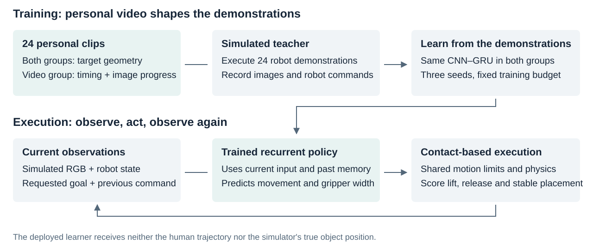

# From personal video to robot commands

[Overview](OVERVIEW.md) · [Experiments](EXPERIMENTS.md) · [Data](DATA_MODEL_CARD.md)

## The two roles of personal video

In the simple-transfer study, real phone images trained a visual encoder. After adaptation to simulated images, it estimated the block's XY position for a fixed grasp controller. Hand and object candidates were auxiliary training targets, not deployment inputs.

In the four-goal timing study, personal clips supplied target geometry and, for one condition, coarse transport timing and image progress. The policy itself learned from rendered robot images and executed robot commands. Phone RGB and hand keypoints were not additional policy inputs or losses in this comparison.

## 1. Build training profiles

The 24 selected clips provide blue target centers from their first frames. The video condition also uses coarse visible transfer intervals and dimensionless two-dimensional object progress. Missing detections remain masked. These profiles describe visible image motion, not calibrated airborne human XYZ trajectories or exact contact events.

The paper-board layout is mapped to a simulated tabletop through an engineered coordinate mapping. This is not calibrated registration to a real robot. [Source selection and boundaries](DATA_MODEL_CARD.md).

## 2. Collect robot demonstrations

A shared scripted teacher performs grasp, lift, transport, release and withdrawal using contact dynamics. The teacher may use the true initial object position. In the video condition, the matching clip constrains transport duration and progress; the two conditions match before transport.

The simulation records each pre-action image, robot observation and effective robot command. Those commands become the learning targets. Both conditions keep all 24 teacher attempts, including four strict-placement failures each; all 24 achieve qualified lifts. Twelve additional teacher trajectories support validation.

The teacher is a data-collection tool. The deployed learner never calls its stages. [Intervention audit](../experiments/personal_video_timing_v4/artifacts/intervention_audit_v1/REPORT_EN.md).

## 3. Train a recurrent policy

A small CNN encodes each 128-pixel RGB image. A causal GRU combines that feature with twelve robot/goal/previous-command values and its history. The model predicts goal-relative absolute XY, absolute Z and gripper width. Shared coordinate decoding, inverse kinematics and an 8 mm step limit turn that output into executable commands.

Both conditions use the same 227,268-parameter architecture, paired initial weights, episode sampling and photometric augmentation. Seeds 7, 17 and 27 each receive 2,500 updates, with fixed-final EMA weights used for evaluation. Demonstration lengths differ, so frame-target counts and compute are not identical. [Frozen configuration](../experiments/personal_video_timing_v4/configs/policy_v1.json).

## 4. Execute and score independently

| Available to the learner | Kept outside the learner |
|---|---|
| Current simulated RGB | True object position |
| Robot proprioception | Teacher stage or scripted grasp decisions |
| Goal chosen before the trial | Future outcomes and scoring flags |
| Previous effective command and recurrent memory | Human trajectory and an external episode clock |

Recurrent state resets at the beginning of each trial. It may encode elapsed progress from observation history. Torch inference runs in a separate process from Bullet physics on the recorded Windows runtime.

The scoring process uses simulator truth to check qualified lift, release, withdrawal, full-footprint goal containment and stability. The block moves through simulated contact forces; it is not attached to the gripper or teleported.

## Why errors compound

The learner trains on teacher trajectories, then encounters its own imperfect states during execution. A slightly misplaced first closure can miss the block, leaving later transport commands without an object to carry. In the latest evaluation, most failures lack a qualified lift. This is evidence of a control bottleneck, not a complete causal diagnosis of every failure.

[All results and failure counts](../experiments/personal_video_timing_v4/RESULTS_EN.md) · [Implementation map](CODE_MAP.md)
