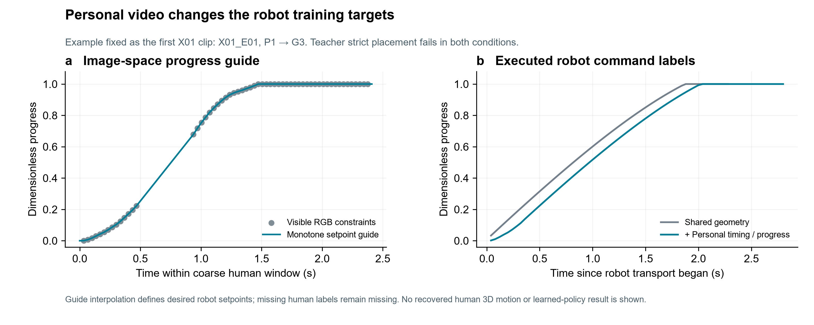

# Personal information actually used

All 24 paired trajectories have identical pre-transport inputs and commands. Each intervention changes the executed transport command sequence. The figure uses X01_E01, the first named X01 training clip; both teachers fail strict placement on that example.

The human curve is a monotone envelope of visible RGB projections inside coarse event brackets. Its timing is approximate. Interpolation produces desired robot setpoints, while missing human observations remain null. Shared engineering speed limits and target settling affect the executed robot schedule.

|Source|P/G|Human window (s)|Baseline transport (s)|Video transport (s)|Max command-progress difference|
|---|---|---:|---:|---:|---:|
|S01_E01|P1_G1|2.64|2.24|3.00|0.156|
|S01_E02|P2_G2|1.84|2.84|3.12|0.159|
|S01_E03|P3_G3|1.96|2.20|2.32|0.063|
|S01_E04|P4_G4|2.04|2.88|3.16|0.175|
|S01_E05|P1_G1|2.12|2.20|2.48|0.000|
|S01_E06|P2_G2|1.64|2.84|3.00|0.088|
|S01_E07|P3_G3|2.16|2.20|2.52|0.039|
|S01_E08|P4_G4|2.16|2.84|3.04|0.121|
|X01_E01|P1_G3|2.41|2.28|2.80|0.094|
|X01_E02|P1_G4|1.84|3.24|3.40|0.093|
|X01_E03|P2_G1|2.78|1.92|3.16|0.320|
|X01_E04|P2_G4|1.74|2.92|3.12|0.127|
|X01_E05|P3_G1|1.54|2.28|2.48|0.136|
|X01_E06|P3_G2|1.54|3.24|3.24|0.000|
|X01_E07|P4_G2|1.58|2.96|3.04|0.070|
|X01_E08|P4_G3|1.81|1.88|2.20|0.141|
|X01_E09|P1_G3|2.44|2.28|2.84|0.151|
|X01_E10|P1_G4|2.35|3.28|3.44|0.102|
|X01_E11|P2_G1|1.54|1.88|1.92|0.000|
|X01_E12|P2_G4|2.44|2.92|3.12|0.123|
|X01_E13|P3_G1|1.54|2.28|2.36|0.031|
|X01_E14|P3_G2|1.31|3.28|3.28|0.000|
|X01_E15|P4_G2|1.54|2.92|2.92|0.000|
|X01_E16|P4_G3|1.58|1.88|2.00|0.077|

This verifies a computational contribution of the personal recordings; it does not establish a policy-success benefit.

